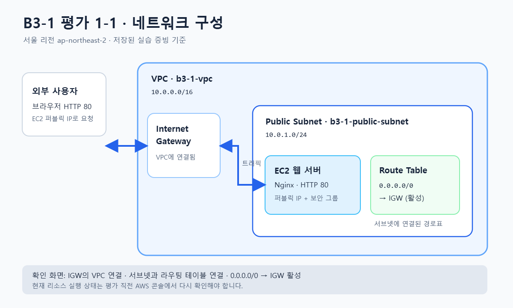

# B3-1 AWS 클라우드 배포 미션

## 프로젝트 목적

AWS에 웹 서버를 배포하고 외부 접속을 확인한 뒤, 구성·문제 해결·리소스 정리 과정을 기록합니다.

## 평가 1-1: VPC·Public Subnet·Internet Gateway·Route Table

아래 그림은 **실습 당시 저장한 증빙 기준**의 구성입니다. 현재 AWS 리소스 상태는 평가 직전에 콘솔에서 다시 확인해야 합니다.

| 확인할 설정 | 실제 화면 |
| --- | --- |
| 서브넷이 VPC 안에 생성됨 | [05-서브넷-VPC-연결.png](05-서브넷-VPC-연결.png) |
| Internet Gateway가 `b3-1-vpc`에 연결됨 | [13-IGW-VPC-연결완료.png](13-IGW-VPC-연결완료.png) |
| 서브넷에 연결된 Route Table의 `0.0.0.0/0 → IGW` 경로가 활성 상태 | [14-라우팅-서브넷-연결완료.png](14-라우팅-서브넷-연결완료.png) |

평가 때는 그림으로 구성 요소의 역할과 연결을 설명하고, 표의 콘솔 화면으로 실제 설정을 보여줍니다. [미션 제출용 구조도](docs/architecture.png)도 별도로 있습니다.

## 필수 제출물

- README: 외부 접속 확인 방식, URL 또는 IP, 결과
- 구조도: 외부 사용자부터 서비스까지의 흐름 (`docs/architecture.png` 또는 PDF)
- 외부접속-성공.png
- 실제 문제 해결 기록 (`docs/troubleshooting.md`)
- AWS 리소스 정리 기록 (`docs/cleanup-checklist.md`)

## 외부 접속 검증

- 검증 방식: A, 외부 브라우저에서 HTTP 접속
- 접속 주소: http://54.181.1.148 (실습 당시 퍼블릭 IP)
- 결과: Nginx 기본 페이지 표시
- 증빙: [외부 접속 성공 화면](외부접속-성공.png)
- 인스턴스 내부: `curl -I http://localhost`에서 HTTP 200 확인
- 아웃바운드: `curl -I https://example.com`에서 HTTP/2 200 확인
- 주의: 인스턴스를 종료하면 위 주소로 접속할 수 없으며 재시작 시 공인 IP가 달라질 수 있다.

## 구현 현황과 남은 작업

- VPC: b3-1-vpc (10.0.0.0/16)
- 서브넷: b3-1-public-subnet (10.0.1.0/24)
- 인터넷 게이트웨이: cdy, igw-03cd847dd8c2ea224, VPC 연결 확인
- 라우팅 테이블: cdy, rtb-04b0e56289f04d61b, `0.0.0.0/0`에서 위 IGW로 향함
- EC2: cdy, i-081121aca74954e4e, Amazon Linux 2023, Nginx
- 보안 그룹: HTTP 80 전체 허용, SSH 22 특정 공인 IP /32 허용
-  남은 작업: IAM 권한 확인, 평가 시연 후 리소스 정리 및 검증
- IAM 평가 확인 필요: 실습에 사용한 cdy 사용자에 전체 권한 정책이 있어 최소 권한 충족으로 기록할 수 없다.
