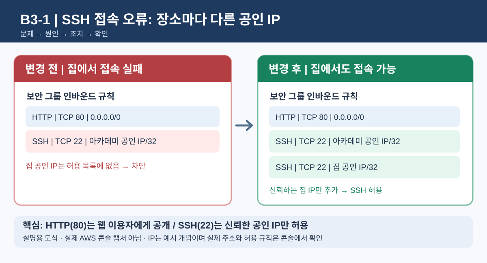

# 문제 해결 기록

실제 오류가 발생하면 아래 항목을 작성합니다.

## 사례 1

- 증상:
- 가설:
- 검증:
- 조치:
- 결과:
- 재발 방지:

## 실제 사례: VPC 목록에서 조회 권한 오류

- 증상: b3-1-student로 VPC 목록을 볼 때 `ec2:DescribeAccountAttributes` 및 `ec2:DescribeDhcpOptions`에 대한 액세스 거부가 나타났다.
- 가설: 사용자에게 연결한 조회 정책에 해당 작업이 빠져 있다.
- 검증: 오류 메시지에 거부된 작업명이 표시됐고, 당시 정책의 Action 목록에 두 작업이 없었다.
- 조치: 계정 관리자가 조회 정책에 두 작업을 추가했다.
- 결과: b3-1-student로 다시 로그인한 뒤 VPC 목록과 b3-1-vpc를 확인했다. 이후 라우팅 테이블에서 별도의 DescribeVpnGateways 권한 오류도 확인됐다.
- 재발 방지: 콘솔이 요구하는 조회 작업을 공식 문서 및 권한 오류 메시지와 대조하고 필요한 권한을 검증한다.
- 증거: 프로젝트 루트의 `01-vpc-권한오류.png`, `02-DHCP-권한오류.png`, `03-조회권한-수정완료.png`, `04-VPC-조회성공.png`.

## 실제 사례: 집과 아카데미의 공인 IP 차이로 SSH 접속 제한

> **증빙 확인(2026-11-21):** 사용자가 2026-11-17과 2026-11-19에 제공한 AWS 콘솔 원본 캡처를 재검토함. 11월 19일 실제 인바운드 규칙 화면에서 **SSH(TCP 22) `121.135.181.35/32`, SSH(TCP 22) `116.33.43.30/32`, HTTP(TCP 80) `0.0.0.0/0`**의 세 규칙이 확인됨. 11월 17일 캡처에는 `내 IP`를 통한 `116...` 규칙 추가 화면이 보임. 이 실제 캡처는 아직 GitHub에 업로드하지 않았으며, 아래 SVG만 설명용 도식임.

- **증상:** 아카데미에서 사용하던 SSH 접속 설정을 집에서 그대로 사용했을 때 EC2 SSH(22번 포트) 접근에 문제가 생겼다.
- **원인 가설:** EC2 보안 그룹 인바운드 SSH 규칙이 기존 접속 장소의 공인 IP `121.135.181.35/32`만 허용하는 경우 집의 공인 IP `116.33.43.30/32`로부터의 SSH 요청은 차단된다. 이 두 주소는 실제 캡처에 등장한다.
- **검증 방법:** (1) AWS 보안 그룹의 SSH 22번 포트 **소스 IP** 확인 → (2) 접속할 장소의 **현재 공인 IP** 확인 → (3) 두 주소가 일치하는지 대조. SSH 개인 키 권한 오류나 EC2 상태 문제도 별도로 구분.
- **조치:** EC2 → 보안 그룹 → 인바운드 규칙에서 **`내 IP`로 SSH(TCP 22) 소스 `116.33.43.30/32`를 추가**한 화면(11월 17일)과, 이후 **SSH(TCP 22) 두 규칙이 동시에 등록된 화면**(11월 19일)을 확인했다. HTTP(TCP 80) `0.0.0.0/0` 규칙은 유지했다.
- **결과:** 2026-11-19 인바운드 규칙 화면에서 두 공인 IP가 각각 SSH 22번에 허용된 사실을 확인했다. **이 캡처는 보안 그룹 설정의 증빙**이며 실제 집 회선에서 SSH 연결 성공까지 독립적으로 증명하는 자료는 아님.
- **재발 방지:** 집과 아카데미처럼 네트워크가 바뀔 때 SSH 규칙의 소스 IP를 다시 확인한다. 편의를 위해 SSH 22번을 `0.0.0.0/0`으로 열지 않는다.
- **주의:** 일반 퍼블릭 IPv4 주소나 인터넷 제공업체에 따라 집의 공인 IP도 바뀔 수 있으며, EC2를 재생성하면 **서버 공인 IP**도 달라질 수 있다. **접속자 공인 IP(보안 그룹의 소스)**와 **EC2 공인 IP(접속 대상)**는 서로 다른 주소다.

### 설명용 도식

### 관련 GitHub 원본 자료

- [보안 그룹 인바운드 설정 캡처](../15-보안그룹-인바운드.png) — SSH 22번과 HTTP 80번 규칙을 확인하는 자료.
- [SSH 접속 성공 캡처](../18-SSH-접속성공.png) — SSH 접속 성공을 확인하는 자료.
- **추가로 발견한 원본 캡처:** `image(20261117-151545).png` (집 IP 규칙을 추가하는 AWS 편집 화면), `image(20261119-080849).png` (SSH 22번에 `121.135.181.35/32` 및 `116.33.43.30/32` 둘 다 등록된 결과 화면). 이 두 사진은 **대화에 제공된 실제 캡처이며 아직 GitHub 저장소에는 업로드되지 않음**. 평가 자료로 사용하려면 원본을 저장소에 추가할 것.

### 동료평가 때 설명할 문장

> "아카데미와 집은 공인 IP가 달라서 기존 보안 그룹의 SSH 허용 주소만으로는 집에서 접속하지 못할 수 있었습니다. 보안 그룹의 22번 포트 소스 IP와 현재 접속 장소의 공인 IP를 비교한 뒤, 신뢰하는 IP를 /32로 허용해 해결했습니다. HTTP 80번은 웹사이트 공개용이고, SSH 22번은 관리자 접속용이라 제한했습니다."
